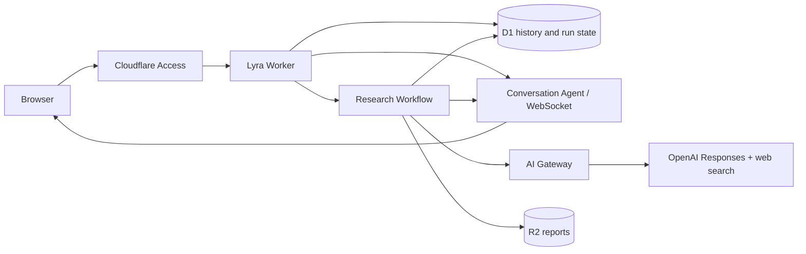

# Architecture

## Decisions

- TypeScript across the repository, pnpm workspaces, and Turborepo task dependencies.
- React Router framework mode runs on Workers through Cloudflare's Vite integration. Each future app gets an independent deployment and resource set.
- UI primitives live in `@citadel/ui`; app-specific views stay in their app. Inter is self-hosted from the Google Fonts family through Fontsource. Shared semantic tokens provide the neutral light theme.
- D1 is the source of truth. Agents coordinate live conversation delivery without maintaining a second copy of the transcript. R2 stores downloadable report artifacts.
- Cloudflare Workflows checkpoint application-controlled research. The OpenAI Responses API supplies models and hosted web search; there is no second agent framework competing with Workflows.
- Research is read-only. Retrieved text is untrusted evidence. Source IDs and URLs are preserved through synthesis; arbitrary HTML is never rendered in the UI.

## Runs and recovery

`Chat` creates a durable reply run. `Deep research` first creates a planning run. Essential clarification is returned as a chat message; otherwise a pending plan is saved. New messages supersede pending plans. Approval atomically creates a single research run using the planning run's immutable model/effort settings. Composer changes apply to future messages; revising a plan adopts those settings.

Run states are `queued → running → completed`, with `failed`, `limited`, `cancelled`, and `uncertain` alternatives. A D1 partial unique index allows one active run per conversation. Another unique index allows at most one execution of an approved plan. Client submission UUIDs make request retries idempotent. A scheduled handler redispatches queued jobs using stable Workflow IDs, applies deadlines, and retries provider cancellation.

Each paid provider submission first writes a durable intent in `run_steps`. Once OpenAI confirms a response ID, that ID is saved before the stream closes. Background responses continue independently of the connection. Reads and polling can retry; creation requests have SDK and Workflow retries disabled. If acceptance cannot be determined, the run becomes `uncertain` and blocks new submissions until cancelled. This cannot guarantee exactly-once billing across a provider/network failure, and deliberately avoids silently issuing the same paid request twice.

Chat text streams through the Agent and periodically saves partial text. Research progress and completed evidence save in D1 before live notifications. Clients reload snapshots on reconnect, visibility changes, and a five-second fallback interval. Refreshing does not approve a plan or restart research.

Research uses up to six questions and divides a total allowance of 24 tool calls across them. Synthesis has no search tool. Each run has a 30-minute deadline; responses have an output token limit. OpenAI's tool-call limit is the provider-side bound, while recorded usage reflects returned calls. Limit and failure paths preserve completed evidence and partial chat text. Cancellation is best effort for an already submitted provider request; already consumed tokens remain billable.

Cost estimates require explicit model rates in `MODEL_PRICING_JSON`; missing pricing shows unavailable instead of a fabricated estimate. Provider invoices remain authoritative.

## Operational limits

Context is bounded to the most recent 24 messages and 64,000 characters; the UI retains older messages, but they may not be included in a new model request. File search, retrieval indexing, generated code execution, private-source MCP connections, and multi-agent fan-out are deferred.

Relevant upstream documentation: [Workers + React Router](https://developers.cloudflare.com/workers/framework-guides/web-apps/react-router/), [Agents + Workflows](https://developers.cloudflare.com/agents/concepts/workflows/), [OpenAI background mode](https://developers.openai.com/api/docs/guides/background), [OpenAI web search](https://developers.openai.com/api/docs/guides/tools-web-search).
